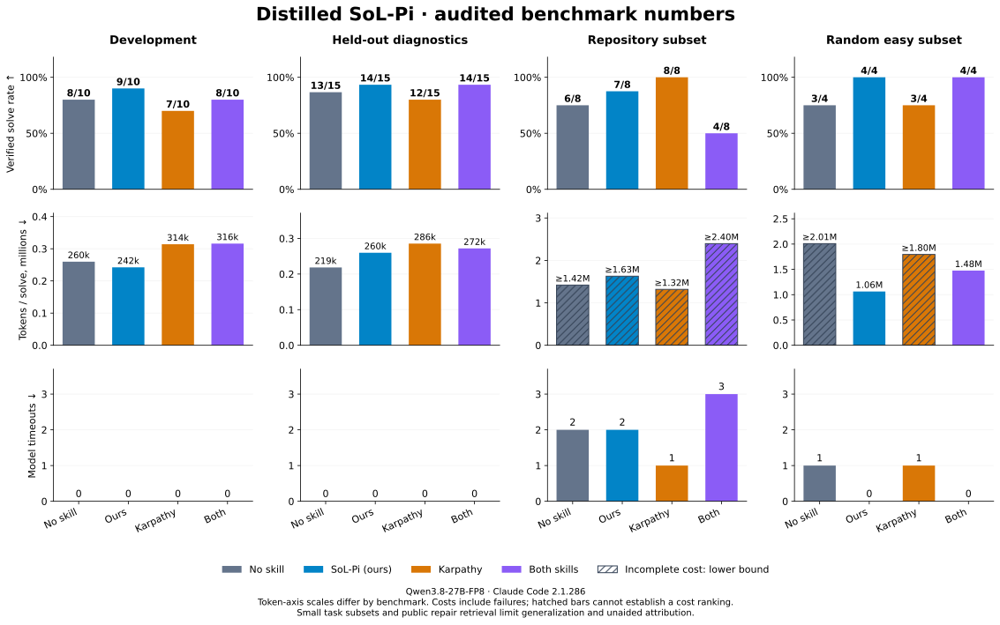

# Distilled SoL-Pi

**Read less. Reuse evidence. Verify the fix.**

A portable `efficient-coding` skill for coding agents. It turns ideas from NVlabs' SoL-Pi harness paper into plain instructions, with the goal of fewer repeated reads and fewer wasted tool calls, at the same or better solve rate. Every claim is measured against no skill and against Karpathy's coding guidelines.

**Status (2026-10-12):** the shipped skill is unchanged. The newest candidate is being re-tested on 196 Aider polyglot tasks (G3, running). No general token-saving win is established yet; see [Results](#2-results).

<details>
<summary><b>Upstream sources: what comes from where</b> (click to expand)</summary>

This repository is **not a fork**. It is an independent, instruction-level distillation. No upstream code is copied.

| Source | What it is | How this repo uses it |
|---|---|---|
| **SoL-Pi paper**: Liu et al., *SoL-Pi: Recursively Scaling Auto-Research Loops for Efficient Agent Harness*, [arXiv 2609.20519v1](https://arxiv.org/pdf/2609.20519v1) | NVlabs research on making coding-agent harnesses cheaper | Ideas only, rewritten as instructions. Digest with page locators: [sol-pi-evidence.md](skills/efficient-coding/references/sol-pi-evidence.md) |
| **SoL-Pi code**: [NVlabs/SoL-Pi @ `1559b5c`](https://github.com/NVlabs/SoL-Pi/tree/1559b5cb12c72da4a485bc50fe326586b216fb19) | TypeScript extensions for the Pi agent harness | Read to check what each mechanism really does. Not copied or bundled |
| **Karpathy guidelines**: [multica-ai/andrej-karpathy-skills](https://github.com/multica-ai/andrej-karpathy-skills) (MIT) | A short coding-behaviour skill | Used **only as a comparison arm**. The frozen test copy is [here](tests/framework/refinement/g2/frozen/karpathy/SKILL.md). None of its rules are in our skill |

**What the SoL-Pi paper reports (author-reported, not reproduced here).** Four mechanisms survived the authors' search:

| Upstream mechanism | What it does in the Pi harness |
|---|---|
| M1 Action Fusion | Runs a predefined check right after an edit, saving one model round trip |
| M2 Online Context Compact | Compacts context at plan boundaries when the projected saving beats the cache cost |
| M3 ObservationPack | Archives large tool outputs and later replaces them with a handle plus exact paged recall |
| M4 Evidence-Preserving Reducer | A cheaper model extracts evidence from long logs, with hash, status and quote checks |

On their 51-task EdgeBench evaluation, the paper reports performance comparable to Pi while cutting recorded token traffic by 44.7–49.0% and API cost by about one third. These numbers belong to the paper's runtime mechanisms. An instruction-only skill does not inherit them.

</details>

---

## 1. Project

### Purpose

Coding agents spend most of their tokens re-reading context: every request replays earlier files, logs and tool output. SoL-Pi cuts this inside the harness. This project asks a narrower, portable question:

> **Can plain skill instructions, without harness changes, reduce tokens per verified solve while keeping the solve rate?**

A skill is just a Markdown file, so if it works it can be installed into any agent (Claude Code, Codex, Cursor) without changing the runtime.

### Motivation

- **Cost grows with trajectory length.** A 20,000-token log kept in context for 20 requests is replayed as 400,000 tokens. Habits like reading only the decisive lines avoid that replay.
- **Runtime fixes are not portable.** SoL-Pi's mechanisms need the Pi harness. Many users can only change instructions.
- **Saving tokens is worthless if solves drop.** So the target is cost per *verified* solve, counting every failed run.
- **Skill claims are rarely tested.** We compare against no skill and against a popular general skill (Karpathy), under fixed, preregistered rules.

### Design: from harness mechanisms to instructions

| SoL-Pi mechanism | Closest instruction in our skill | What cannot transfer |
|---|---|---|
| M1 Action Fusion | Batch independent reads; pair an edit with its predetermined check when the tool allows it | A real fused edit-and-run tool |
| M3 ObservationPack | Keep long output in a file or log; search for the decisive error and read nearby lines | Replacing past messages with handles |
| M4 Evidence Reducer | Check a quoted diagnostic against its source; capture the true exit status before filtering output | A cheaper helper model |
| M2 Context Compact | On resumption, reconcile notes with current files instead of redoing work | Native compaction and cache economics |
| (added) Retry hygiene | Fix rejected tool arguments instead of repeating them; re-plan after repeated failures | — |

The shipped entrypoint is [SKILL.md](skills/efficient-coding/SKILL.md) (2,584 bytes, SHA-256 `68ea78dc…`). Optional references and offline helper scripts load only when needed.

### Benchmarks

| Benchmark | Source | What a "solve" means | Used here | Full size |
|---|---|---|---|---:|
| Synthetic diagnostics | Written for this repo | Hidden tests pass | 10 fixtures (5 development + 5 held-out) | — |
| SWE-bench Verified | [princeton-nlp](https://huggingface.co/datasets/princeton-nlp/SWE-bench_Verified) | Official grader resolves the issue | 6 issues | 500 |
| Aider polyglot | [Aider-AI/polyglot-benchmark](https://github.com/Aider-AI/polyglot-benchmark) @ `7e0611e` | Exercise test suite passes | G2: 9 sealed tasks · G3: 196 tasks | 225 |
| Terminal-Bench 2.0 | Terminal-Bench | Task verifier passes | 9 sealed tasks, **not run** | 78 eligible |

All grading runs in isolated Docker containers. For G2 and G3, each task's grader was first checked with the reference solution (must pass) and with no change (must fail); G3 dropped 15 of 211 eligible tasks that failed this check, before any model call. The [Docker framework](tests/framework/README.md) supports nine agent CLIs and six benchmark sources.

### Method

**Four arms, everything else identical:**

| Arm | Skills loaded |
|---|---|
| No skill | none (baseline) |
| Karpathy | Karpathy guidelines |
| **Ours** | our skill (shipped version, or the candidate under test) |
| **Both** | ours + Karpathy, loaded separately |

**Metric.** Tokens per verified solve = all provider tokens of all runs, failures included ÷ number of verified solves. Solve rate is reported next to it.

**Rules that keep it honest:**
- Failures, timeouts and cap hits stay in the totals. No task substitution. Infrastructure-only failures may be rerun once, under the same rule for every arm.
- Candidates are frozen by SHA-256 before confirmation. Confirmation tasks are sealed: drawn by a recorded seed and never used in development.
- Pass rule, fixed before the run: our arm must be **≥ 5% cheaper per solve than No skill and than Karpathy**, Both must be ≥ 5% cheaper than Karpathy, each **paired task-cluster bootstrap 95% interval** of the cost ratio must lie **below 1**, and solves must be **no fewer**.
- Early stopping is allowed only for futility (to stop a loser), never to declare a win.
- Results from different models, agents or task sets are never pooled.

**Pipeline:**

| Stage | Agent · model | What happened |
|---|---|---|
| Original campaign | Claude Code · Qwen3.8-27B-FP8 | Shipped skill vs. 3 arms on synthetic diagnostics and SWE-bench Verified |
| G1: refinement | Codex 0.160.0 · Qwen3.8-27B-FP8 | 19 candidate revisions screened on development tasks; [rejected-candidate index](tests/archive/rejected-candidates/INDEX.md) |
| G2: sealed confirmation | Codex · Qwen3.8-27B-FP8 | Candidate 2 on 9 sealed Aider tasks × 4 arms × 3 rounds |
| G3: large confirmation | Codex · Qwen/Qwen3.8-27B (full precision) | Candidate 2 on 196 Aider tasks × 4 arms × 3 rounds. **Running** |

Candidate 2 = the shipped skill plus one rule: make shell failures visible and confirm a write or test really happened before reasoning from it ([frozen copy](tests/framework/refinement/g2/frozen/candidate/SKILL.md)).

---

## 2. Results

`M` = million tokens, `k` = thousand. `≥` = lower bound (one run's cost was not fully recorded). **TBD** = not measured yet. A fraction like 13/27 counts solved attempts, not unique tasks.

### At a glance

| Question | Answer |
|---|---|
| Does the shipped skill beat no skill? | **Mixed.** More solves on both benchmarks, but more tokens per solve on synthetic diagnostics |
| Does candidate 2 beat no skill? | **Yes on G2** (9 Aider tasks): 62.5% fewer tokens per solve, interval 0.11–0.85, 13 vs 7 solves. G3: **TBD** |
| Does candidate 2 beat Karpathy? | **Not proven.** G2 point estimate ≤ 0.64×, but the interval reaches 1.13. G3 (196 tasks) is designed to settle this: **TBD** |
| Does adding Karpathy on top help? | **No evidence.** Both ≈ Karpathy on G2 |
| Is a general token-saving win established? | **No, not yet** |

### Table A: shipped skill (Claude Code 2.1.286 · Qwen3.8-27B-FP8)



| Benchmark (attempts per arm) | Arm | Solved ↑ | Tokens / solve ↓ | Timeouts ↓ |
|---|---|---:|---:|---:|
| Synthetic diagnostics (25) | No skill | 21/25 | **234k** | 0 |
| | **Ours** | **23/25** | 253k | 0 |
| | Karpathy | 19/25 | 296k | 0 |
| | **Both** | 22/25 | 288k | 0 |
| SWE-bench Verified (12) | No skill | 9/12 | ≥1.62M | 3 |
| | **Ours** | **11/12** | **≥1.42M** | 2 |
| | Karpathy | **11/12** | ≥1.45M | 2 |
| | **Both** | 8/12 | ≥1.94M | 3 |

Synthetic: 5 development fixtures × 2 rounds + 5 held-out × 3 rounds, so it includes development data. SWE-bench: 6 issues × 2 rounds. [PNG](assets/benchmark-numbers.png) · [plot script](tests/scripts/plot_numbers.py) · [full report](tests/report.md).

### Table B: candidate 2 on Aider polyglot (Codex 0.160.0)

| Arm | G2 solved ↑ | G2 tokens / solve ↓ | G3 solved ↑ | G3 tokens / solve ↓ |
|---|---:|---:|---:|---:|
| No skill | 7/27 | 3.38M | TBD / 588 | TBD |
| **Candidate 2 (ours)** | **13/27** | **1.27M** | TBD / 588 | TBD |
| Karpathy | 10/27 | ≥1.98M | TBD / 588 | TBD |
| **Both (ours + Karpathy)** | 11/27 | 2.04M | TBD / 588 | TBD |
| Timeouts, all arms | 0 | | TBD | |

**G2:** Qwen3.8-27B-FP8, 9 sealed tasks × 3 rounds. **G3:** Qwen/Qwen3.8-27B (full precision), 196 tasks × 3 rounds. They are never pooled. G3 progress: round 1 of 3 running; 169 of 784 round-1 runs audited at commit `5c6f69b`. Per-window audits are in [g3/](tests/framework/refinement/g3/).

### Table C: pass/fail comparisons (cost ratio = ours ÷ comparator; below 1 = ours cheaper)

| Comparison | G2 ratio | G2 95% interval | G2 verdict | G3 verdict |
|---|---:|---|---|---|
| Candidate 2 vs No skill | 0.375 | 0.11–0.85 | ✅ Pass | TBD |
| Candidate 2 vs Karpathy | ≤ 0.64 | ≤ 0.31–1.13 | ⚠️ Not proven (interval crosses 1) | TBD |
| Both vs Karpathy | ≤ 1.03 | ≤ 0.35–2.95 | ⚠️ Not proven | TBD |
| **Overall (all three required)** | | | ❌ **Negative**: not shipped | TBD |

Why G2 could not settle the Karpathy comparison: the lead came from 3 of the 9 tasks (alphametics, transpose, accumulate), and resampled task sets without them push the ratio above 1. [G2 report](tests/framework/refinement/g2/report.md) · [G1 report](tests/framework/refinement/g1/report.md).

### Table D: coverage and what is still open

| Benchmark | Sampled | Status |
|---|---|---|
| Synthetic diagnostics | 10 of 10 | Done |
| SWE-bench Verified | 6 of 500 (≈ 1%) | Done; larger sample TBD |
| Aider polyglot | G2: 9 of 225 · G3: 196 of 225 | G2 done · G3 running |
| Terminal-Bench 2.0 | 9 of 78 eligible, sealed | Not run (G2 Aider stage did not pass) |
| Shipped skill on other agents (Pi, Codex, Copilot, Cursor, Antigravity) | 2 reused fixtures, 40 attempts ([native pilot](tests/framework/trials/README.md)) | Pilot only; TBD |

<details>
<summary>Original-version results (earlier 6,573-byte entrypoint, Claude Code 2.1.285; different tasks, not pooled)</summary>

| Benchmark | Arm | Solved ↑ | Tokens / solve ↓ |
|---|---|---:|---:|
| Stress suite | No skill | 15/15 | 194k |
| Stress suite | Original SoL-Pi (ours) | 15/15 | 209k |
| Stress suite | Karpathy | 15/15 | 226k |
| Stress suite | Both skills, original ours | 15/15 | 244k |
| Repository repairs | No skill | 19/24 | 2.40M |
| Repository repairs | Original SoL-Pi (ours) | 19/24 | 2.55M |
| Repository repairs | Karpathy | 19/24 | 2.30M |
| Repository repairs | Both skills, original ours | 19/24 | 2.39M |

</details>

### Limitations

- Small samples, except G3. Repeated attempts on the same task are not independent, so intervals resample whole tasks.
- One model family (Qwen3.8-27B) and two agents. Transfer to other models and agents: **TBD**.
- SWE-bench repairs may draw on public fixes, which limits attribution. Lower-bound (`≥`) costs do not support exact savings figures.
- Scheduling seeds fix task order, not model sampling.

---

## Quick start

Inside Claude Code:

```text
/plugin marketplace add reliable-era/distill-skill-nvlabs-SoL-Pi
/plugin install distill-sol-pi@sol-pi-skills
/distill-sol-pi:efficient-coding Fix the failing parser test and verify the change.
```

For another task:

```text
Use efficient-coding to investigate logs/test-run.log, check the failure
against the source, fix it, and run the affected tests.
```

## Install for your agent

### Claude Code marketplace

Use the commands above. The repository supplies the [marketplace and plugin manifests](.claude-plugin). Installation is tested in Docker and GitHub Actions.

### Skills CLI — Claude Code, Codex, Cursor

**Repository-specific installation validation: TBD.** The commands below follow the Skills CLI documentation; these client installation paths have not been tested here.

Using the [open Skills CLI](https://github.com/vercel-labs/skills), choose your client:

```bash
# Claude Code
npx skills add reliable-era/distill-skill-nvlabs-SoL-Pi --skill efficient-coding --agent claude-code

# Codex
npx skills add reliable-era/distill-skill-nvlabs-SoL-Pi --skill efficient-coding --agent codex

# Cursor
npx skills add reliable-era/distill-skill-nvlabs-SoL-Pi --skill efficient-coding --agent cursor
```

These commands target this GitHub repository. Official marketplace listing: **TBD**. Add `--global` for a user-wide installation. In Codex, invoke with `$efficient-coding`.

### Manual project installation

```bash
gh repo clone reliable-era/distill-skill-nvlabs-SoL-Pi
cd distill-skill-nvlabs-SoL-Pi
TARGET_PROJECT=/absolute/path/to/your/project
mkdir -p "$TARGET_PROJECT/.claude/skills"
cp -R skills/efficient-coding "$TARGET_PROJECT/.claude/skills/"
```

Copy the whole directory; references and helpers are part of the skill. Back up any existing installation before replacing it. A [ZIP distribution](.claude/skills/efficient-coding.zip) is also available.

## Validate an upgrade

```bash
docker build -f tests/validation/Dockerfile -t sol-pi-validation .
docker run --rm --network none sol-pi-validation
```

The [GitHub workflow](.github/workflows/validate.yml) checks manifests, installs the plugin in a fresh non-root container, verifies installed resource bytes, and checks helper entrypoints. No model calls are made; performance upgrades need separate behavioral evaluation.

## Repository map and evidence

| Path | Contents |
|---|---|
| `skills/efficient-coding/` | The shipped skill |
| `tests/eval/` | Original campaign: frozen inputs, grades, audits ([147-attempt audit](tests/eval/pruned/audit/independent-final147-audit.json), [16-attempt audit](tests/eval/random-followup/audit/independent-final16.json), [comparison CSV](tests/eval/pruned/results/comparison.csv)) |
| `tests/framework/` | Docker framework, benchmark adapters, [runtime login steps](tests/framework/runtime/README.md) |
| `tests/framework/refinement/g1`, `g2`, `g3` | Refinement and confirmation runs: plans, seeds, analysis code, audits, reports |
| `tests/archive/rejected-candidates/` | The 19 candidates that were not shipped, with reasons |
| `tests/goal.md` | The preregistered goal contracts (G3 active) |

Runtime dependencies and agent binaries are excluded; manifests keep their hashes. Historical paths identify the original execution workspace. [Issue templates](https://github.com/reliable-era/distill-skill-nvlabs-SoL-Pi/issues/new/choose).
